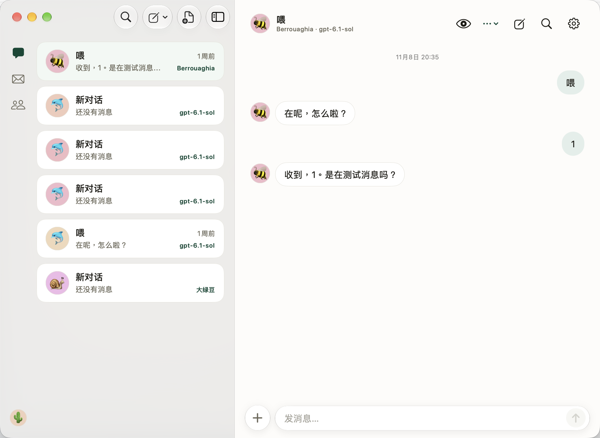

# AAUV / 大绿豆

[简体中文](README.md) | **English**

An AI client with a layout much like WeChat. It includes a sing-box client for bypassing internet restrictions; bring your own proxy node.

Why use it? There isn't really a compelling reason, and this isn't a commercial product. I made it because:

- It is especially useful on iPhone: you can use ChatGPT without turning on a system-wide VPN, which can save a lot of battery.
- You can shape different AIs, much like having different friends on WeChat. This can help avoid some biases.
- It supports BYOK, so you can use any provider. There are plenty of products like this, but mine aims to feel a little friendlier and easier to understand: fewer technical features, more support for the human side. If technical features are what you're after, just use Cherry Studio.



You could also think of it as a standalone version of my other project, [PendingBot](https://github.com/syncmeta/PendingBot).

I'll write a more detailed README later; I have a lot of other things going on at the moment. The rest below was written by AI.

## Sign-in options

| English | Chinese |
| --- | --- |
| Sign in with ChatGPT | 通过ChatGPT登录 |
| Sign in with GitHub Copilot | 通过GitHub Copilot登录 |
| BYOK | 填Base URL和Key |
| Paste Link | 有人给你链接，点这里导入 |

BYOK currently defaults to the Responses API. The Go core parses SSE and validates the terminal state; the interface displays Responses text as it arrives and checks the completion event. Existing conversations retain Chat Completions support. Anthropic Messages is only a reserved protocol identifier. “Sign in with ChatGPT” opens Safari authorization on iOS and the system browser on Mac, using a loopback callback, PKCE, and OpenID signature validation. After validation, credentials are saved to Keychain under their registration ID, and the account's available models are fetched. Previously authorized ChatGPT Plan OAuth credentials can also be imported. Switching saved ChatGPT accounts in settings reloads the model list; conversations already bound to a registration keep using it. Summaries and replies each read valid credentials for the same registration. Explicitly expired credentials are renewed with the refresh token, and concurrent requests sharing credentials share a refresh operation. If a specified registration has no credentials, the app asks you to sign in again or import that registration's credentials. Browser authorization, subscription text requests, and reusing authorization after reopening the app have passed isolated Mac acceptance checks. iOS sign-in and real inference still require physical-device validation.

“Sign in with GitHub Copilot” uses [GitHub device authorization](https://docs.github.com/en/apps/oauth-apps/building-oauth-apps/authorizing-oauth-apps#device-flow) on Mac and iOS. Enable Device Flow in the GitHub application's settings and supply its public Client ID. Custom builds can prefill it with `AAUV_GITHUB_CLIENT_ID`. After confirmation on GitHub, AAUV validates the account identity and saves the authorized credentials to Keychain. To export them as a file or link, choose GitHub Copilot under “Export sign-in method” and enable credential inclusion. The device code is only used for that authorization attempt.

The AAUV project needs to register a GitHub OAuth application with Device Flow enabled once and include its public Client ID in release builds. Each user authorizes their own account; they do not need to register an application or use an AAUV central server. The current local test build does not yet prefill this public Client ID.

Mac builds containing the official runtime load the Copilot model catalog after sign-in. Copilot is enabled when the checks pass. If they fail, the saved GitHub authorization can still be exported. Both “Use GitHub Copilot” and, once enabled, “Check Copilot access” can retry the checks. Mac chat and context compression use the Copilot SDK, with temporary sessions and history and attachments selected by AAUV. The runtime's built-in local tools remain disabled. When AAUV local tools are enabled, only the five fixed functions described below are registered. Authorization and proxy state are checked before starting the runtime and before submitting requests; account or route changes stop old requests. Real Mac account and subscription inference acceptance remains pending.

iOS offers a direct Copilot preview without running the desktop runtime or an AAUV central server. It uses one fixed GitHub authorization, checks account discovery and the model catalog, and prefers Responses where the catalog indicates support. Chat Completions provides basic chat only. Local tools require a model supporting Responses and the corresponding tool capabilities; otherwise the app asks you to change the model or tool settings. An empty model selection is accepted only when the catalog explicitly declares exactly one usable default. The app does not guess model names. A 401, 403, rate limit, or service error does not trigger a retry with another protocol, model, or account. Requests identify AAUV rather than impersonating an editor or extension.

This preview references [VS Code's public HTTP client implementation](https://github.com/microsoft/vscode/blob/d40ade3898b5d93f6739dc8934594ef60663f188/src/vs/platform/agentHost/node/shared/copilotApiService.ts). [GitHub's OAuth documentation](https://docs.github.com/en/copilot/how-tos/copilot-sdk/setup/github-oauth) describes passing user authorization to the SDK; it does not establish that independent HTTP requests from AAUV's own OAuth application will be accepted. Local mock-service and compilation checks have passed. Real accounts, subscription policies, attachment support, and iOS device networking still need validation. Successful catalog access does not establish permission to run inference.

An experimental native account-API orchestration component lives in `copilot/nativeauth`. It uses the pinned SDK's public types and has passed synthetic and race checks. The current chat bridge and interface do not enable it. Real authorization, secure credential storage, and restoration across restarts still need validation. It does not treat the official runtime's signed-in identity as an exportable OAuth token.

“Sign out of Copilot on this device” stops local Copilot requests and removes local and imported Copilot credentials, while retaining chats, bots, and other providers' settings. If credential removal cannot finish, local Copilot use is suspended and a retry is offered. Authorization on GitHub must still be revoked through GitHub's authorization settings; local sign-out does not mean remote authorization has been revoked.

If ChatGPT returns a verified account identity without subscription inference permission, AAUV saves the account and lets you complete authorization in settings or choose BYOK. Known authorization scopes are checked before model requests and after refresh. For older imported credentials without scope information, the OpenAI service checks access. [OpenAI Docs: authorization recovery](https://developers.openai.com/siwc/token-sharing-open-source/errors-and-recovery)

The model catalog checks credentials in the background and verifies the current account before requests and before displaying results. Cancellation or account changes discard late results. After an authorization code expires, settings can resume sign-in with the original registration. If OpenAI explicitly reports that a refresh token is invalid, AAUV removes the invalid access and refresh tokens while retaining the account registration for reauthorization. Temporary network and service errors retain credentials.

You can sign out of the current ChatGPT account in settings. AAUV cancels that account's active requests, waits for any refresh in progress, attempts to revoke the refresh token, and then removes local access, refresh, and identity tokens from Keychain. The registration and conversations remain available for use after reauthorization. If remote revocation cannot be confirmed, settings show that local sign-out is complete and provide a link to manage application authorizations. [OpenAI Docs: accounts and sessions](https://developers.openai.com/siwc/token-sharing-open-source/profiles-and-sessions)

Explicit model-service failures retain the HTTP status, error code, parameter, and request identifier locally when the provider supplies them. If ChatGPT explicitly reports that subscription usage is exhausted, subscription requests for that account are suspended. You can inspect usage in settings and manually resume them. [OpenAI Docs: model error recovery](https://developers.openai.com/siwc/token-sharing-open-source/errors-and-recovery)

## Configuration files and links

Open “Paste Link” in settings to paste a configuration or single-node link, or choose a configuration file. The preview lists services, bots, prompts, context settings, and credential counts. Nothing is saved until confirmation. Generated links can be copied separately to the clipboard.

Configuration files, links, and backups without credentials use a local public-settings snapshot without reading Keychain. Read-only export remains available when Keychain is temporarily unavailable or configuration recovery is unfinished. Configuration import, backup restoration, and exports containing credentials wait for recovery. Credential-bearing exports read the original account's authorization in the background. Cancellation, account changes, or export-option changes prevent late results from replacing a newer operation.

Configuration import first stages credentials and settings in local Keychain, then records a commit marker in the SQLite transaction that saves bots and prompts. If the app exits midway, reopening completes a committed import or removes staging for an uncommitted import in the background. The window shows recovery progress; model requests and configuration changes pause until it finishes. If the system cannot complete recovery temporarily, you can retry from the conversation list. A credential refresh blocks new configuration imports from the time it is sent until the renewed credentials are saved. Pending import recovery runs before refreshing credentials to avoid interleaving imports with single-use refresh credentials. Default bot display and file sharing read local metadata without keys; sign-in credentials remain in Keychain.

Readable files use JSON, preferably with the `.aauv` or `.aauv.json` extension.

```json
{
  "format": "aauv-config",
  "version": 4,
  "loginMethod": "byok",
  "endpoint": "https://api.example.com/v1",
  "model": "example-model",
  "key": "EXAMPLE_ONLY",
  "nodeLinks": []
}
```

`loginMethod` accepts `chatgpt`, `copilot`, or `byok`. Older single `key` and `oauth` fields remain importable. Version 4 can carry other providers' default models and BYOK URLs and protocols in `providerDefaults`, multiple API keys indexed by Base URL in `credentials.byokKeys`, multiple ChatGPT authorizations in `credentials.chatGPT`, and one GitHub Copilot authorization in `credentials.copilot`. `credentials.preferredChatGPTClientID` selects a default ChatGPT registration.

An OAuth object contains `flow`, `access_token`, and optional `refresh_token`, `id_token`, `client_id`, `expires_at` (Unix seconds), and `scopes`. ChatGPT uses `chatgptPlan` and requires the original `client_id`. Copilot uses `githubCopilot`. Imported authorization is stored in local Keychain. Imports update credentials for the same Base URL or ChatGPT registration while retaining other saved credentials. ChatGPT Plan credentials are used only with OpenAI's official inference and refresh endpoints.

Configuration and application-settings backups can also declare `selectedProxyNode` (a node's SHA-256 ID), `proxyRequiresTunnel`, `githubCopilotClientID`, and `cloudSyncEnabled`. Missing fields in older files retain local selections. An explicit empty string clears a node selection or the sign-in form's Client ID. A public application Client ID does not replace the original registration of existing OAuth credentials. Node selection carries a reference only; node URIs and credentials remain controlled by credential inclusion. If the node has not been imported, the selection is retained until you add it or choose another node. A configuration requiring a proxy makes requests wait for a connection; importing it does not automatically operate the system VPN. The preview shows the iCloud sync switch, which is applied only after confirmation.

Links use `aauv://import?v=2&c=zlib#payload`. The payload is UTF-8 JSON compressed with standard zlib, then encoded as unpadded Base64URL. If compression does not shorten the content, `c=none` is used. Paste Link supports older `aauv1` encoding and raw JSON. Decoded link configurations are limited to 1 MiB. Larger configurations can be imported from a file, up to 64 MiB. Encoding is a transport format: anyone holding a link can decode its contents.

`defaultBotSelection` carries the bot used for new conversations and opened files: `{"mode":"defaults"}` uses the default service, `{"mode":"profile","profileID":"bot UUID"}` selects a saved bot, and `{"mode":"custom","snapshot":{...}}` uses an independent configuration. Omitting the field retains the current selection. The selected bot appears in the import preview. Missing bots or ChatGPT selections without their original registration produce explicit errors. Restoring bots as backup copies remaps this reference. Files already queued in the share inbox retain the bot captured when they arrived.

Exports omit sign-in and node credentials by default. Enabling credential inclusion exports authorization referenced by default services, saved bots, or conversations, together with saved single-node links. Under “Network & Proxy → Single-node proxy,” you can directly paste and import Shadowsocks (`ss`), VMess, VLESS, Trojan, Hysteria2 (including `hy2`), TUIC, or SOCKS5 links; Paste Link also remains available. Direct import validates the node before saving and selecting it. Connection is triggered explicitly by the user; a failed import preserves the input and previous selection. Full sing-box JSON configurations can still be imported on the same page. Importing a node alone retains the current model and authorization; nodes inside configuration imports are merged and deduplicated. Nodes that skip TLS certificate verification require separate confirmation before connecting. Conversion currently supports VLESS Reality and common WebSocket, gRPC, and HTTPUpgrade transports. XHTTP, PendingNet redemption, subscription updates, and options unsupported by the core remain pending.

Links containing ECH, whole-certificate fingerprint pinning (`pcs` or `pinSHA256`), separate certificate-name verification (`vcn`), or Reality ML-DSA-65 verification (`pqv`) report the unsupported parameter explicitly. Saved nodes containing these options also show the reason and disable connection. [Xray sharing-link proposal](https://github.com/XTLS/Xray-core/discussions/716) · [Hysteria 2 URI specification](https://v2.hysteria.network/docs/developers/URI-Scheme/)

PendingNet `pendingnet://pair` links require exchanging pairing credentials with the node server and checking expiration and certificate binding. Management links are not ordinary node imports.

## Bots and model services

Selecting a bot opens an unsaved conversation on the right, with settings and a letter-writing entry. Unsent text and attachment drafts remain in the current window. The conversation joins the message list only when its first message is saved. A failed save preserves the draft; failed attachment copying does not leave an empty conversation. After an ordinary user message, a manually generated request, or a voice transcription is saved successfully, that bot becomes the most recently used bot. Waiting for or interrupting a reply does not undo this choice. Assistant completion, voice playback completion, and retrying an old request do not replace a later user selection. Unsaved previews and failed saves do not change it. Queued files retain their captured bot. The ordinary new-conversation entry uses the same flow; opening a file through the system still creates a conversation through the file entry. While waiting for a reply, typing status appears only at the top.

New bots default to random names from PendingBot's world place-name list. You can edit the name or randomize it again. Avatars use the original UUID seed rules, so the card preview, saved list, and chat share the same identity. Existing bots are not renamed automatically. The creation page shows an avatar, name, and model, with a choice of saved services and their models.

Manage multiple services under “Me → Model services → Saved services and models.” Each service retains its own model list, with manual additions, display-name edits, and explicit refresh. Failures preserve the previous list. Supported models in saved services can also receive multi-model delegations without creating another bot. Identical model names across endpoints or accounts use precise targets rather than guessing. ChatGPT catalogs are isolated by authorization registration; BYOK catalogs are distinguished by URL and API protocol. Existing defaults, bots, and conversation model settings are added to the local catalog on first launch. Model lists can be exported through configuration files, links, and application-settings backups, while credentials remain controlled by the separate inclusion option. Services and model lists also sync through iCloud; keys and OAuth credentials stay on each device.

Display profiles and service catalogs sync independently, so changing one does not overwrite the other. New devices prefer the existing cloud profile on their first join. Concurrent offline edits to the same catalog use the newer modification version, including an explicitly emptied catalog. The selected account, proxy node, and connection state remain device-specific. Automatic profile and catalog sync requires compatible AAUV versions on both devices.

## Manual letters

“Letters” is a separate tab. “Ask it to write” starts generation immediately, without asking for a prompt. For the same bot identity, AAUV takes the selected-answer branch from the most recent ordinary conversation, capturing its text and original times. The new request encourages a natural continuation without prescribing a letter, greeting, or sign-off format. Without history, it starts a topic naturally. Background context follows the current window, compression, and historical-sampling settings and is saved with the generation record; retries use that snapshot. You can expand it for inspection. Older letters with manually entered instructions retain their text.

Old chat attachments keep only known references for explicit attachment tools, sync, and backup; clicking the button does not upload them all again. Attachments from unselected answer branches are excluded. Background snapshots are limited to 8 MiB and 50,000 records, with an explicit error if exceeded. The snapshot belongs to the generation record and is exported and synced with it. Generation uses the bot's existing prompts, skills, model, authorization, proxy, and stop/retry flow. The text can be exported as plain text or Markdown. Content is generated only after an explicit click.

## Opening files and backing up data

AAUV registers as an optional handler for ordinary files. macOS can open multiple files at startup or while the app is running. Opening `.aauv`, `.aauv.json`, or JSON up to 64 MiB with the top-level `aauv-config` marker shows a configuration preview. Opening `.aauvbackup` shows its contents and selectable restoration items. Configurations and backups are read in the background and imported only after confirmation. Other ordinary files are copied in the background, saved to AAUV's data directory, and used to create a conversation with the most recently used bot at the time of opening. Opening a file performs local import only. Files can also be chosen from AAUV's toolbar.

On iOS, choose “大绿豆” or “AAUV” in the system share sheet to send files to the local App Group inbox. System-opened files and files chosen from the toolbar also go there first. The inbox captures the most recently used bot when each file arrives; delayed processing and retries retain it. Older queued files without this snapshot use the most recent bot at processing time. Each ordinary file creates a conversation, while configurations and backups show previews in order. If some files cannot be copied, successfully copied files remain importable. Uncommitted files are retained; reopening the app or choosing “Continue pending file imports” resumes them, and individual items can be removed from the preview. Import receipts commit with their conversation or configuration; processed files are cleaned up on reopening. The iPhone simulator has passed system-share-sheet reception of a binary file and configuration together, with original bytes and the preview checked. Physical-device signing requires `group.com.pendingname.aauv` on both the main app and `com.pendingname.aauv.Share` extension.

Existing conversations can select multiple files using the paperclip beside the composer. Individual files can be removed before sending. Attachments are saved, synced, and backed up with their message and sent with both the initial request and retries. Attachments from earlier messages remain in history and can be added again. Conversations created by opening ordinary files continue to include their original file in every request.

Choose “Attach again” on a conversation attachment, including a model-generated image, to prepare it for the next message. AAUV preserves its original filename and image type for subsequent viewing or editing by a model. The click prepares a local copy; upload happens when you send it.

Long-press or right-click your question to regenerate its answer. The request uses that question's time as the context-window endpoint, includes its original attachments, and uses the conversation's currently selected bot. Original and regenerated answers are retained together. Choosing “Use this answer” makes subsequent chat and voice use that version. Answers and selections sync and back up with the conversation.

The conversation list and individual conversation toolbars can search local records by title, bot name, message text, or attachment filename. Keywords are matched literally, ignoring case for English letters. Results can open a conversation or jump to the original message. Imported and synced local content is searchable offline.

ChatGPT subscription and Chat Completions attachments use JSON requests with chunked encoding. For BYOK Responses requests with attachments totaling more than 10 MiB, AAUV first tries the Files API through the same service URL and proxy, then submits file IDs. If Files explicitly rejects an attachment format, that file is sent inline; successful uploads retain their IDs and order. If the Files endpoint is unavailable or rejects expiration parameters, remaining files use inline transmission. Uploads request a one-hour expiration, and AAUV attempts to delete temporary uploads after completion, failure, or cancellation. The macOS Copilot bridge reads local attachments directly, encodes their original bytes, and passes them to the official runtime. Providers and models determine supported formats and sizes.

When a BYOK Responses service returns Code Interpreter file references, AAUV downloads the original files using the same API URL, credentials, and proxy. After a complete reply is confirmed, its text and references are saved first; successful downloads are then attached to that reply. Each reply can download up to 32 files totaling 32 MiB. If waiting is stopped or downloads fail, saved text and successfully downloaded files remain, with unsaved files marked on the reply. Generated files are backed up and synced through iCloud with the conversation and can be saved through the system share menu.

Default BYOK bots and individual bots can enable web search, hosted Code Interpreter, and hosted image generation in Responses settings. The selected provider performs image generation; support depends on the service and model. After a complete reply, AAUV decodes returned images in the background and saves them as reply attachments, including image-only replies. Images and Code Interpreter files share the limit of 32 files and 32 MiB per reply. Failed items are marked as unsaved. Common local image attachments show thumbnails in messages, while original files remain available through sharing, backup, and sync. ChatGPT subscription settings enable only web search, with actual availability depending on model and account policy. Tool settings can be exported in configuration files and links. When a provider reports an active tool, the message page shows its progress. [OpenAI image generation tool](https://developers.openai.com/api/docs/guides/tools-image-generation)

“Allow bots to use local tools” is enabled by default and can be included in configuration files, links, and backups. ChatGPT subscription, BYOK Responses, and tool-capable Copilot requests can provide five tools: search the current conversation's history, save a skill automatically, read historical attachments from the current conversation, delegate to another configured cloud model, and attach an HTTPS or `data:image` image. Disabling the setting removes these functions from new requests and stops active tool chains. Basic Chat Completions provides neither these tool descriptions nor their execution. The list contains no local shell or code execution.

“Tool activity” below each question expands to show tools actually started by the most recent request, their completion states, and result counts. Records are stored in local SQLite and travel with message backup and sync. Regeneration starts a fresh record set. In-progress records reopened locally or on another device show “Incomplete / state unconfirmed”; old records alone never indicate that a tool is still running. Sync merges preserve observed completion states, and late records from old runs cannot restore a cleared trace. Only fixed fields, processed search previews, and skill names are saved—not raw tool arguments, attachment bodies, delegated questions and answers, full errors, or credentials. These traces are excluded from the message window and are not sent to models. A successful tool action is not automatically repeated if saving its trace fails.

History search is limited to the current conversation and supports keywords, date ranges, and result limits. Automatically created skills are saved to the shared library, disabled globally by default, and enabled in the current conversation for the next request. Historical attachments are selected by local UUID; only the question and selected files are sent to the cloud. Multi-model delegation selects a target through a configured bot or service route and sends one independent question. It inherits no parent history, prompts, skills, or tools and cannot recursively delegate. If a model name has multiple routes, `bot:UUID` selects a specific bot. Anthropic Messages remains a protocol placeholder and is not an available delegation target.

The image-attachment tool uses existing images; it does not generate them. One user request can successfully prepare up to five images, each up to 25 MiB and totaling 125 MiB. HTTPS downloads and `data:image` decoding validate the actual image format. Inline `data:image` content is also bounded by the function-argument size limit and cannot fill the entire download allowance in one call. Original bytes are saved as reply attachments. This allowance is separate from the provider's 32 MiB Code Interpreter/image-generation limit. Completed attachments can survive cancellation or a later round failure while the original conversation and authorization remain valid. Account, bot, network-route, or local-tool-setting changes prevent old results from entering a new context. Responses tool chains retain original reasoning, phase, and complete function-call pairs across at most 12 request rounds and 40 function calls. Failed calls with side effects are not automatically replayed.

After successfully invoking the image-attachment tool, a model can finish without additional text. AAUV accepts this only when local attachments are ready and a valid successful terminal state has arrived. Ordinary empty replies, missing terminal events, and failures still produce errors. The Copilot bridge checks actual tool results against local attachments rather than accepting an empty reply solely because the model claims to have attached an image.

Backups can be saved through the system file picker as a single `.aauvbackup` file in iCloud Drive. They use standard ZIP, compressing conversation, bot, and shared-prompt manifests in the background and streaming original attachment bytes. Model services, context settings, hosted tools, and voice-model settings are included by default and can be turned off before export. Sign-in credentials and proxy-node links migrate through a separate configuration export. Restoration validates manifests, attachment sizes, and ZIP checksums. After confirmation, attachment copies are prepared in the background, moved into the local library, and committed with conversations and bots. Shared prompts/skills and application settings can each be selected for restoration. Interrupted settings publication resumes on reopening. Older JSON backups remain importable. The local conversation directory permits system backup, and independently exported files are not affected by CloudKit deletions.

Completed assistant replies use native Markdown rendering for headings, lists, quotes, tables, and copyable code blocks. SwiftMath renders LaTeX locally. Wide code blocks and tables scroll horizontally. External images appear as links or placeholders; the chat view does not automatically contact image hosts. Message source remains plain text for storage and export. Responses web citations open from numbered references or the sources below a reply; sources are saved, backed up, and synced with the text.

## Building

Requires full Xcode, Go 1.26, and XcodeGen. The first build fetches pinned GitHub commits and downloads Go dependencies. Build tools and outputs stay inside the AAUV directory.

```sh
Scripts/build-proxy.sh
Scripts/build-core.sh
# Run this for Copilot on Mac. The default builds the host architecture; all includes Apple Silicon and Intel.
Scripts/build-copilot.sh
xcodegen
xcodebuild -project AAUV.xcodeproj -scheme AAUV_macOS \
  -destination 'generic/platform=macOS' -derivedDataPath build/mac \
  ARCHS=arm64 CODE_SIGNING_ALLOWED=NO build
xcodebuild -project AAUV.xcodeproj -scheme AAUV_iOS \
  -destination 'generic/platform=iOS' -derivedDataPath build/ios \
  CODE_SIGNING_ALLOWED=NO build
```

After dependencies and the Apple core framework are prepared, `Scripts/test-local.sh` can run while the Mac is locked. Synthetic fixtures cover the Go core, Copilot bridge and experimental account orchestration, startup recovery, default bot metadata, request credentials, conversation concurrency, context compression, backups, sync merging, and legacy-cache migration. They do not sign in to real accounts or write to CloudKit. Native tests retain the complete Keychain adapter, but each process uses an independent random service name so error paths cannot read production credentials. Logs go to `build/local-tests`. Pass test names to run selected Swift regressions, for example `Scripts/test-local.sh ConfigurationRecoveryTests RequestCredentialsTests`. The Xcode builds above still check the complete interface and Markdown rendering.

Realtime voice exposes only the `hang_up` tool. After the model requests a hang-up in a complete, successful current response, AAUV waits for received audio to finish playing, saves the final transcript and usage, and closes the connection and microphone. User interruption, a new response, or manual termination cancels that wait. Cancellation, incomplete responses, and old calls cannot trigger the tool. The five ordinary-chat local tools are not provided to voice sessions. `RealtimeVoiceTests` uses a real local mock WebSocket service, while `VoiceRunToolTests` uses fake audio and transport to check the complete lifecycle without accessing a microphone or model account. [OpenAI Realtime event reference](https://developers.openai.com/api/reference/resources/realtime/server-events)

After preparing universal proxy/core binaries and running `Scripts/build-copilot.sh all`, `Scripts/package-macos.sh` creates `build/dist/AAUV-macOS-local.zip`. It contains a universal Apple Silicon/Intel Release app and matching source archive, using local ad-hoc signing. Official Copilot runtimes retain upstream signatures and original bytes. The local test package is not notarized; iCloud requires separate team/container signing configuration. Without those capabilities, the sync settings show an explanation.

Set `AAUV_MAC_SIGNING_IDENTITY` to a local certificate name or SHA-1 to produce a development-signed package with the same script. For example: `AAUV_MAC_SIGNING_IDENTITY='Apple Development: YOUR NAME (TEAMID)' Scripts/package-macos.sh build/dist/AAUV-macOS-development.zip`. Packaging and ordinary Xcode builds with signing enabled sign AAUV-owned code and the proxy core while retaining upstream Copilot runtime signatures. Development-signed packages still require a matching provisioning profile for iCloud.

A signing identity alone does not embed a profile or add CloudKit entitlements. For a local CloudKit Development package, explicitly supply an AAUV macOS Development profile, the approved development certificate's SHA-1 (40 hexadecimal characters), and the target Mac identifier covered by the profile:

```sh
AAUV_MAC_SIGNING_IDENTITY='YOUR_APPROVED_CERTIFICATE_SHA1' \
AAUV_MAC_PROVISIONING_PROFILE='/path/to/AAUV_Development.provisionprofile' \
AAUV_MAC_DEVICE_ID='YOUR_REGISTERED_MAC_DEVICE_ID' \
Scripts/package-macos.sh build/dist/AAUV-macOS-cloudkit-development.zip
```

The profile must specifically authorize `com.pendingname.aauv`, `iCloud.com.pendingname.aauv`, CloudKit, the Development environment, and development push, and include the target Mac and selected certificate. The script verifies the CMS content signature and authorized values, uses concrete signing entitlements rather than copying profile wildcards, and then checks actual entitlements, certificate, team, embedded profile, and complete signature. It does not register devices, configure Apple's backend, or enumerate Keychain identities. CMS content-signature checks do not replace Apple's provisioning trust or actual system execution acceptance. This mode uses the explicitly specified local signing private key and produces an unnotarized local development package, not a public release. Each invocation requires a previously nonexistent output path; existing ZIPs and separate source archives are not overwritten. Matching source is generated directly from the current workspace.

`python3 Tests/macos-development-profile-tests.py` runs targeted packaging-entitlement and overwrite-rejection regressions without signing or launching an application.

Mac and iOS proxy cores are built from [sing-box v1.14.3](https://github.com/SagerNet/sing-box/tree/7054cac5124465ffdb145870d7c01885566711b1). Scripts check the commit and enable build options for AAUV's supported protocols. The Mac core includes arm64 and x86_64. iOS builds arm64 device, arm64 simulator, and x86_64 simulator slices sequentially, then combines them into one XCFramework to reduce peak build disk usage. Pass `macos` or `ios` to `Scripts/build-proxy.sh` to build a single platform. Both Go frameworks use the project-local SagerNet gomobile v0.1.12.

The Mac build embeds `Vendor/sing-box`. Set both `AAUV_SING_BOX_BINARY` and `AAUV_SING_BOX_LICENSE` to use a specified core and license notice; the binary must cover the target architectures. At runtime, you can import a full configuration with one mixed inbound listening on `127.0.0.1`. AAUV adds temporary inbound authentication and validates a local SOCKS5 handshake before routing model requests through it. Both platforms remember the selected node. Once connection begins, failed connections and app restarts still require reconnecting or explicitly restoring direct access before new model requests can start. Chat, summaries, attachments, and authorization requests verify their captured route before sending. Connection-state or direct-access changes invalidate the old route.

iOS runs the project-built `Vendor/Libbox.xcframework` in a Packet Tunnel extension. Its first start requires accepting the system VPN prompt. Requests requiring the proxy are released only after the system reports a connected tunnel. Choosing “Stop” during configuration preparation or connection cancels that attempt. Node configurations are validated with `sing-box check` on macOS; real iOS tunnel connectivity remains pending. Physical-device signing requires the Packet Tunnel Provider capability.

The Mac Copilot bridge uses Go SDK v1.0.28 and checks GitHub Copilot runtime v1.0.105 against release hashes. Unmodified architecture-specific runtimes and their license files are embedded during the build. Bridge source lives in `copilot/`; runtime redistribution follows GitHub's own license.

## Proxy core and licensing

The current core is sing-box/Libbox: a separate process on Mac and Libbox in Packet Tunnel on iOS. Single-node parsing and conversion share the Go core. This choice reflects the integrated platform interfaces, pinned builds, and coverage of common protocols. Node-link storage is separate from core configuration conversion to leave room for a later Xray-core/libXray replacement. Two cores are not currently integrated together.

AAUV-owned source and migrated PendingBot/PendingNet code retain their MIT notices. The iOS tunnel extension statically combined with Libbox is distributed under GPL-3.0-or-later, with original MIT and upstream notices included. The separate Mac sing-box process follows its GPL license. See `Licenses/AAUV-Distribution.txt` for the current distribution scope. Matching source and pinned dependencies accompany the local Mac package. Precompiled Copilot runtimes follow their independent license. Xray-core uses MPL-2.0, and the libXray wrapper uses MIT. [GNU license compatibility](https://www.gnu.org/licenses/license-compatibility.en.html)

From a development directory with dependencies prepared, `python3 Scripts/package-source.py` produces `build/dist/AAUV-source.tar.gz`. It includes pinned sing-box and Swift sources, local SwiftPM mirrors, a Go file proxy, and Android SQLite source. Versions and checksums are recorded in `ThirdPartySources/inventory.json`. See the [third-party notices](THIRD_PARTY.md) for licenses.

In an extracted `AAUV-source` directory, configure local Go dependencies first, then follow the build steps above. A separate module cache avoids using dependencies already downloaded elsewhere on the machine.

```sh
export GOENV=off GOTOOLCHAIN=local GOWORK=off GOSUMDB=off
export GOPROXY="$(python3 -c 'from pathlib import Path; print(Path("ThirdPartySources/go-proxy").resolve().as_uri())')"
export GOMODCACHE="$PWD/build/go-modules"
Scripts/build-proxy.sh
Scripts/build-core.sh
xcodegen
python3 Scripts/configure-offline-swift.py
```

You can add `-scmProvider system -skipPackageUpdates -disablePackageRepositoryCache -onlyUsePackageVersionsFromResolvedFile` to the `xcodebuild` commands. Android still needs a preinstalled JDK, SDK, and NDK. Precompiled Copilot runtimes are distributed under an independent license and are prepared separately when needed.

- [sing-box license](https://github.com/SagerNet/sing-box/blob/testing/LICENSE)
- [Xray-core license](https://github.com/XTLS/Xray-core/blob/main/LICENSE)
- [libXray license](https://github.com/XTLS/libXray/blob/main/LICENSE)
- [ChatGPT native authorization reference](https://developers.openai.com/siwc/token-sharing-open-source/sign-in)
- [GitHub Copilot SDK authorization reference](https://docs.github.com/en/copilot/how-tos/copilot-sdk/setup/github-oauth)

## Local data and iCloud

An existing PendingBot `pendingbot.sqlite` cache copy (local cache migration v9 or newer) can be converted offline to an AAUV backup on Mac. Quit the old app before copying it. If matching `-wal` and `-shm` files remain, copy them as well. The source database is opened read-only. Encrypted caches require a SQLCipher command-line tool and the original cache passphrase, entered in the local terminal. `--sqlcipher /path/to/sqlcipher` selects the tool.

```sh
python3 Scripts/migrate-pendingbot-cache.py /path/to/pendingbot.sqlite /path/to/PendingBot.aauvbackup \
  --base-url https://api.example.com/v1 --model example-model
```

Conversion preserves titles, bot names, message text, times, and explicit reply relationships from locally cached one-to-one bot conversations. Imported bots use the command's BYOK URL and model. The resulting backup can be previewed and imported through AAUV's backup entry. The old cache has no original attachment files, prompts, or skills, and contains only records cached on that device. Group chats, person-to-person chats, system messages, and withdrawn or replaced messages are skipped. Exported backups contain chat text and should be handled as local chat data.

Multiple answers to one question follow the old cache's answer grouping. The earliest answer retains its original bubbles; each later answer is merged into one selectable candidate, separated by blank lines and using the time of that candidate's first bubble. Only the selected answer enters subsequent context. Old caches do not record the selection, so imports default to the earliest answer, which can be changed in the conversation. Messages without grouping or a valid question association are retained unchanged.

The Go core stores conversations, messages, compression state, and unfinished replies in SQLite. Apple platforms use system SQLite. Legacy JSON imports once within a transaction and leaves the original file intact. Responses text is streamed to the interface and periodically written to SQLite. A valid completion event allows final reply processing. Early connection termination preserves partial text and request state. Retries are user-triggered; an already submitted request may incur usage again. Retry confirmation is bound to the message at that time. Multiple windows on one device share conversation occupancy state. A synced conversation deletion cancels its local active requests.

The message menu can delete an individual user message or model answer. Confirmation removes its text and attachment references and invalidates the active generation or call, old summary, and compression progress. Other messages remain; answers whose original question was deleted still appear chronologically and enter context. With sync enabled, deletion markers propagate to other devices and take priority over late old messages. Replaying the same marker does not interrupt later new requests. Shared attachments remain. Cleanup attempts only unreferenced local files belonging to that deletion, without scanning newly staged files. Old backups can restore copies with new identities, including remapped references for orphaned answers. Devices using individual-message deletion sync need a compatible AAUV update.

Conversation titles can be edited manually. Cloud-generated titles are optional and off by default. When enabled, new text conversations ask the current model to derive a title from up to 12 recent text messages after the first completed round and rounds 3, 6, 9, and so on. Failures preserve the previous title; manual renaming takes priority. This uses an extra cloud-model request with separately recorded usage. File-opened conversations retain the original filename. The switch can migrate with configuration and application-settings backups.

Shared prompts and bot prompts can be imported from UTF-8 files. Skills are Markdown text with individual names, editing, and enable switches; bulk imports are disabled by default. Older monolithic skill text remains effective. Prompts and skills live in local SQLite and can be imported/exported through settings files and links. With iCloud enabled, older prompt JSON is migrated into sync records using its file modification time, and the original file remains. “Manage bots” in settings saves configurations for names, models, sign-in methods, prompts, skills, and provider-hosted tools. New conversations can choose a bot. Opened files default to the bot used for the most recent saved user content. Each conversation retains its own bot configuration. After importing old conversations or updating a bot, “Change bot” in the conversation toolbar can continue with the current default or another saved configuration. Confirmation shows the new service URL. History and attachments remain with the conversation; shared prompts and skills are application settings. Configuration files and links can carry bot records. The original backend's main prompt still needs export from its Langfuse environment. The first version excludes proactive messages, scheduled tasks, and group chats.

The bot editor reads the current ChatGPT account in the background. Saving waits for that read. Switching services, closing the editor, or selecting another account cancels the old binding intent. Read failures preserve the existing binding.

Ordinary chat and voice startup provide the model with the current bot name, request time, and local time zone. Raw user messages in the window include their sending times, using the offset applicable at that time for daylight saving. Unknown times are not invented. Time hints are added only to outbound copies; original text, character-window counts, and generated memory data remain unchanged. Summaries, attachment reads, and cloud delegations retain their own isolated prompts. Rendering rules live in the shared Go core, with time-zone data bundled into it.

An empty prompt offers “Fill in the 大绿豆 conversation style,” which can be edited and saved normally. The template references PendingBot's pre-Langfuse `0921fc7c:apps/edge/prompts/zh/system.md`, retaining its conversational tone and verification principles while adapting it to AAUV's current capabilities. Both shared and per-bot prompts can use it.

When migrating from PendingBot, choose “Import from Langfuse JSON…” in the prompt editor and select a prompt export or a single text prompt's API response. For bulk export, include all versions; AAUV extracts the unique `system/zh` version labeled `production`. Only the text body is imported, retaining existing skills and model settings. Review old service template variables and tool descriptions in the editor before confirming. Files are read locally without Langfuse credentials. [Langfuse bulk export](https://langfuse.com/changelog/2026-08-06-bulk-import-export-prompts)

BYOK conversations can start a one-person voice call from the toolbar. AAUV connects directly to a Realtime WebSocket at the same Base URL, with an editable `gpt-realtime` default. The call starts with the current message window and local prompts. Speaking can interrupt playback; completed transcripts remain when the call ends. Transcripts are ordinary conversation messages and travel with backups and sync. Microphone and model audio are handled only during the call. Real microphone, speaker, and online-account behavior still needs validation. [OpenAI Realtime documentation](https://developers.openai.com/api/docs/guides/realtime-conversations)

Apple platforms can enable CloudKit private-database sync. CKSyncEngine syncs conversations, original messages, attachments, bots, prompts and skills, display profiles, and saved service/model catalogs. Within a conversation, newer message text, attachment references, and replica records commit together. Legacy differences between local text and replica records are repaired when opening the database. Deletion markers take priority over old conversations. Stale records are skipped before writing local attachments, while identical replays can still repair missing files. Records with attachments use streaming ZIP files; the old 32 MiB application limit has been removed, with iCloud quota and free device space still applying. Generated files sync with their replies. New versions can read older JSON sync records; receiving newer attachment packets requires an AAUV update. Failed uploads remain queued while other records continue. Deleting an ordinary sync zone pauses sync even if a zone with the same name appears in the same event batch. “Restore iCloud sync from local records” can explicitly queue a complete local copy for the original account. When Apple explicitly reports encrypted-data reset, the current library stays local and old sync stops; offline use and export remain available. Account changes pause uploads until the original account returns. Credentials, compression results, model usage, and unfinished replies stay local. Usage records provider-reported input and output tokens by model and chat/compression purpose. The system schedules automatic sync; manual triggering is also available.

Mac/iOS builds and Development signing have validation records, and local offline merging has been tested with two SQLite stores. Dedicated Development acceptance programs on Mac and a physical iPhone 12 mini completed one foreground exchange of synthetic text and attachments in both directions, followed by test-cloud-resource cleanup. This does not cover background push, locked screens, recovery into a nonempty library, or iCloud Production. Builds still need their own `iCloud.com.pendingname.aauv` container and corresponding signing capabilities.

If a synced ChatGPT bot or conversation lacks local authorization, the ChatGPT section lists its name and offers “Authorize this device.” An explicit click uses the record's original registration ID without changing conversation bindings. Use the same original ChatGPT user and workspace. Each device stores its own credentials; CloudKit does not copy refresh tokens. Existing local registrations retain their reauthorization entry. Authorization and workspace consistency on a second physical device still need acceptance.

Incoming iCloud records are read in background batches. A batch's SQLite write and local view refresh do not interleave with other local edits. ZIPs containing attachments are processed separately to bound temporary disk usage.

If a local sync checkpoint is temporarily unreadable, AAUV pauses sync. Once it is readable again, “Sync now” reloads the original account binding and zone state. Local conversations and backups remain usable.

On offline startup, temporary network errors before engine creation use automatic backoff and honor CloudKit's requested delay. A system account-status change rechecks the sync account. Returning to the foreground also catches up: Mac uses application-level reactivation after leaving the app; iOS uses scene activation. First launch uses the existing startup sync, and multiple Mac windows share one activation entry. Rapid switches coalesce. While a sync is running, at most one foreground request is retained, processed only after that sync succeeds. Failures keep the existing backoff without creating a new fetch loop. Once the engine is running, CloudKit schedules retries for offline conditions and rate limits. Missing attachments and upload failures needing manual attention preserve the failed revision in the local queue while other records continue. Record updates, reopening, or “Sync now” can attempt the upload again. [CloudKit throttling](https://developer.apple.com/documentation/technotes/tn3162-understanding-cloudkit-throttles) · [CKSyncEngine retries](https://developer.apple.com/documentation/cloudkit/cksyncengine-4b4w9?language=objc)

Startup sync and “Sync now” also check missing local attachments. Reading their corresponding iCloud records can repair them even when those records have not changed since the previous sync. Repair follows normal record-version checks. iCloud settings show the count still missing.

Manual sync, foreground checks, and the engine's automatic checks directly read incremental changes in AAUV's zone to catch updates the engine did not discover. The independent zone cursor advances only after corresponding records are saved successfully. Cancellation, account changes, and write failures preserve the prior progress. An explicit server-reported token expiry replays the zone through normal version merging. “No local records waiting to upload” means only that the local upload queue is empty; settings separately show the last completed check and last received update.

Initial sync and zone rebuilding read the upload queue in pages by record name and revision. Relevant message bodies are read only when constructing an actual upload batch. If a record changes while its attachments are being prepared, the newer revision remains pending.

`core/` is compiled with gomobile into the shared Apple `AAUVCore.xcframework` and Android `AAUVCore.aar`. Go manages SQLite and protocols; Swift manages Apple networking, files, secure credentials, and CloudKit.

## Shared Android core

Prepare Go 1.26, a JDK, Python 3, an Android SDK platform, and the NDK. API 35 and NDK r28c are the currently validated setup. The NDK can live under the SDK's `ndk/` directory or be selected with `ANDROID_NDK_HOME`.

```sh
ANDROID_HOME=/path/to/android-sdk \
JAVA_HOME=/path/to/jdk \
Scripts/build-android-core.sh
```

The output is `Vendor/AAUVCore.aar`, with minimum API 24, arm64-v8a and x86_64, and native libraries aligned to 16 KiB. The build downloads and verifies SQLite 3.54.1 and links it statically into the Android library.

Android applications can include it with `implementation(files("libs/AAUVCore.aar"))`. Call `go.Seq.setContext(applicationContext)` to provide the Android environment, then open an application-private database with `com.pendingname.aauv.aauvcore.Aauvcore.openLocalStore`. The artifact currently contains local storage, message windows, backups, request construction, and stream parsing. Android UI, network/credential adapters, and physical-device execution still need development and validation.

The same AAR includes fixed local-tool definitions, Responses function calls and raw-continuation validation, plus conversation-history search and skill transactions through `LocalStore.executeConversationTool`. The Android adapter must still validate the current UI, authorization, and network route and handle cloud delegation, uploads, and image files. Core support is not a complete Android app.

It also provides `LocalStore.deleteMessage`, `LocalStore.attachmentReferences`, and `Aauvcore.renderRuntimeContext`. The core handles deletion and sync priority. Rendering inputs use Unix seconds; the adapter supplies the local IANA time zone and fixed offset, and sends only the rendered copy to the model. Originals remain the input for storage and character-window counts.

Configuration links use the same codec as Apple platforms. Java or Kotlin can generate a link with `Aauvcore.encodeConfigurationLink(byte[])` and retrieve UTF-8 JSON with `Aauvcore.decodeConfigurationLink(String)`. The caller validates fields and writes credentials to the device's secure storage.

Memory compression reuses the same Go methods. `planWindowSummaryBatches` accepts the planner's `overflow` message array and returns an array of JSON strings, each containing one message batch. Call `buildWindowSummaryPrompt` for each request and validate each summary with `isWindowSummaryValid`. Finally, call `buildCompressedWindowContext` with `summary`, `compressedSamples`, `historicalSamples`, and `sampleLimit`. Optional `roundScoped` marks current-round samples; `firstOffset` and `currentPromptTail` describe the retained raw fragment at the window's start.

Configuration version 3 provides `apiProtocol` and `hostedTools`. Older configurations without a protocol use Chat Completions. Code Interpreter is called only as a supporting provider's hosted tool; AAUV disables local code execution.

## Sliding context window

Each request filters the current conversation by message time, retaining the default last 24 hours in conversation order. Messages later than the request time are skipped for that request. Up to 100,000 Unicode code points, the window remains raw text. Above that threshold, the latest 30,000 characters are retained; only a message crossing the retained boundary needs splitting. Earlier raw text within the time window is compressed. Time expiration alone does not call a model while raw text remaining in the window is below the threshold. Complete original messages always stay local.

Settings provide a character slider from 10,000 to 200,000 in steps of 5,000. Trigger and retained counts stay linked at 10:3, such as 50,000 / 15,000. The time window is independent at 1–168 hours. Both sample groups share a separate count setting from 0 to 50, defaulting to 10 per group; if fewer messages are available, all are retained. Configuration files and links carry `contextPolicy: {threshold: 100000, hours: 24, samples: 10}`. Older configurations without it retain current window settings.

Compression uses the current cloud model with hosted tools disabled. Each round randomly samples up to 10 entries from that round's compressed raw text and up to 10 from older history outside the round. Text compressed in previous rounds is older history. Both groups retain IDs, roles, and Unix-second timestamps, with an explicit note that omitted messages may exist between adjacent samples. A sampled split-boundary message includes only the portion compressed in that round and identifies its position. Summaries, samples, attachments, and explanatory notes use additional context space. Attachments do not currently count toward the message-character threshold.

Summaries are merged incrementally in complete JSON message batches of up to 25,000 code points, targeting at most 4,000 characters. A result above 8,000 produces an error for retry. Fragments of a long message spanning batches retain the same message ID and their original offsets. Compression stores the summary, samples, cutoff message ID, split count, and raw-text fingerprint. A summary is reused only while the complete compressed text and settings still match. The next threshold considers the summary and uncompressed messages still within the time window. Both random-sample groups are sent with requests but their length does not trigger another compression. Changes to older history resample it while permitting reuse of a valid summary. Partial time expiration, synced earlier messages entering the window, or settings changes recalculate from the current window. Compression failure preserves raw text and prior results. Backups can retain the cache, which is rebuilt as needed after restoring copies. Older caches covering whole messages remain readable. Messages without timestamps are candidates only for older-history samples. Compression incurs additional model usage. An isolated Mac has validated initial compression and next-round summary reuse with a real cloud model at the 10,000-character setting; that check did not cover the default 100,000-character load.

After each valid batch summary, the device saves compression progress for the round. Interrupted later batches can resume from the last checkpoint, including after reopening the app. Resumption requires matching raw text, existing summary, context settings, and selected model service. Progress stays in that device's library.

Compression batching now lives in the shared core. Compression unfinished before the upgrade restarts using the new batches. Completed summaries and original messages remain usable.
