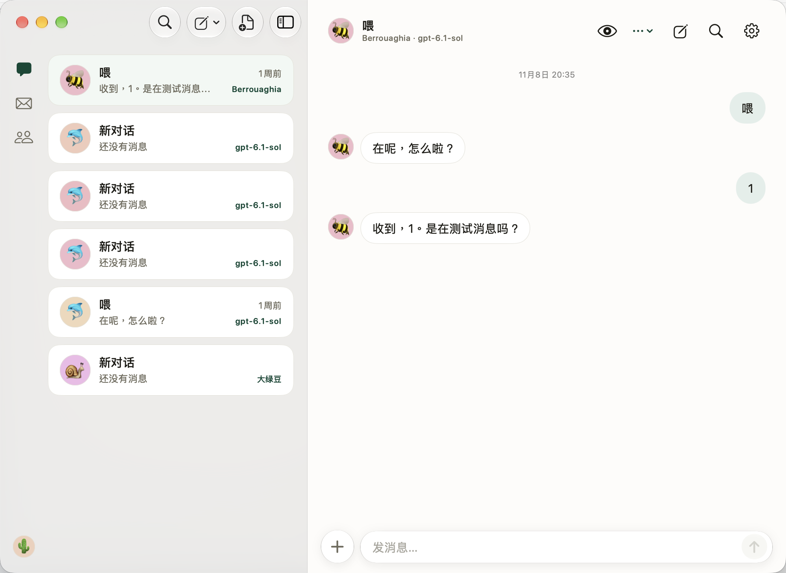

# AAUV / 大绿豆

**简体中文** | [English](README.en.md)

一个AI客户端，形态跟微信差不多。内置sing-box客户端（俗称VPN）（节点需自备）

为什么要用这个？其实没什么理由，这也不是一个商业产品。我做它的理由有：

- 在iPhone上特别有用，无需开全局VPN即可使用ChatGPT，这能省很多电
- 你能培养不同的AI，就像微信上你有很多好友。这能避免一些偏见。
- 可以BYOK，用任意厂商服务。这类产品非常多，但我这个相对亲切明白一点。技术上的功能少，人文上的支持多。如果看中技术上的功能，用Cherry Studio就好了。



README我晚些时候详细写，最近其它事情有点多。以下是AI写的。

## 登录入口

| 英文 | 中文 |
| --- | --- |
| Sign in with ChatGPT | 通过ChatGPT登录 |
| Sign in with GitHub Copilot | 通过GitHub Copilot登录 |
| BYOK | 填Base URL和Key |
| Paste Link | 有人给你链接，点这里导入 |

当前 BYOK 默认使用 Responses API，Go 核心解析 SSE 并验证终态，界面实时显示 Responses 正文，并检查完成事件。旧会话保留 Chat Completions；Anthropic Messages 仅预留协议标识。「通过 ChatGPT 登录」在 iOS 打开 Safari 授权页，Mac 打开系统浏览器，使用回环回调、PKCE 和 OpenID 签名校验。验证成功后按注册 ID 将凭证写入钥匙串，并读取账户可用模型。也可导入已授权的 ChatGPT Plan OAuth 凭证。在设置切换已保存的 ChatGPT 账户时会重新读取其模型列表，已绑定注册的会话继续使用原注册。摘要与回复请求分别读取同一注册的有效凭证。凭证明确过期时通过 refresh token 续期，同一份凭证的并发请求共享续期。已指定的注册缺少凭证时，应用会要求重新登录或导入该注册的凭证。浏览器授权、订阅文本请求和重开应用后复用授权，已在隔离 Mac 验收环境跑通；iOS 登录和真实推理仍待真机验收。

「通过 GitHub Copilot 登录」在 Mac 和 iOS 使用 [GitHub 设备授权](https://docs.github.com/en/apps/oauth-apps/building-oauth-apps/authorizing-oauth-apps#device-flow)。需在 GitHub 应用设置启用 Device Flow，并填写该应用的公开 Client ID。自建版本可通过构建设置 `AAUV_GITHUB_CLIENT_ID` 预填。用户在 GitHub 确认后，AAUV 验证账户身份，将授权成功的凭证存到钥匙串。可以在「导出登录方式」选择 GitHub Copilot，再开启包含凭证来导出文件或链接。设备码只用于本次授权。

Copilot 的设备授权需要 AAUV 项目注册一次启用 Device Flow 的 GitHub OAuth 应用，将公开 Client ID 配入发行构建；普通用户各自授权，无需自行注册应用，也不需要 AAUV 中央服务器。当前本机测试包尚未预填这一公开 Client ID。

含官方运行时的 Mac 构建会在登录成功后读取 Copilot 模型目录。检查通过后启用 Copilot。检查失败时，仍可导出已保存的 GitHub 授权。设置中的「使用 GitHub Copilot」和启用后的「检查 Copilot 访问权限」都可重试。Mac 的聊天及上下文压缩通过 Copilot SDK 发往 GitHub，使用临时会话和 AAUV 选出的历史、附件。运行时自带的本地工具保持禁用；启用 AAUV 本机工具时，只登记下面五项固定函数。运行时启动前和提交请求前分别核对授权和代理，账户或路径变化会停止旧请求。Mac 的真实账号和订阅推理仍待验收。

iOS 提供 Copilot 直连预览，不启动桌面运行时或 AAUV 中央服务器。应用固定同一份 GitHub 授权，经账户发现与模型目录检查后，按目录支持情况优先使用 Responses；Chat Completions 只提供基础聊天。需要本机工具时，模型必须支持 Responses 和相应工具能力，否则会明确要求更换模型或调整工具设置。空模型仅使用目录明确声明的唯一可用默认模型，不猜测型号；401、403、限流或服务错误不会触发换协议、换模型或换账户重试。请求使用 AAUV 自身标识，不冒充编辑器或插件。

该预览参考 [VS Code 的公开 HTTP 客户端实现](https://github.com/microsoft/vscode/blob/d40ade3898b5d93f6739dc8934594ef60663f188/src/vs/platform/agentHost/node/shared/copilotApiService.ts)。[GitHub OAuth 文档](https://docs.github.com/en/copilot/how-tos/copilot-sdk/setup/github-oauth)说明可将用户授权交给 SDK，尚不能据此保证 AAUV 自有 OAuth 应用的独立 HTTP 请求会被接纳。当前已经过本机模拟服务和编译检查；真实账户、订阅策略、附件支持及 iOS 真机网络仍待验收，目录读取成功也不代表推理请求已获接纳。

原生账号 API 的实验性编排组件位于 `copilot/nativeauth`，使用固定 SDK 的公开类型并通过合成与竞态回归。当前聊天桥接与界面尚未启用它；真实授权、凭证安全保存和跨重启恢复仍需验证。它不会把官方运行时的登录身份当作可导出的 OAuth Token。

设置中的「退出本机 Copilot」会停止本机 Copilot 请求，清除本机和已导入的 Copilot 凭证，并保留聊天、机器人及其他服务商的配置。退出时若无法完成凭证清理，会暂停本机 Copilot 使用，并提供重试入口。GitHub 上的应用授权仍需在授权管理页面撤销，本机退出不代表远端撤销。

若 ChatGPT 返回已验证的账户身份，但未授予订阅推理权限，AAUV 会保存账户，并让用户在设置里补授权或选择 BYOK。模型请求前及续期后都会检查已知的授权范围。旧版导入凭证若省略范围，权限由 OpenAI 服务核验。[OpenAI Docs 授权恢复](https://developers.openai.com/siwc/token-sharing-open-source/errors-and-recovery)

模型目录在后台检查凭证，发请求前和显示结果前核对当前账户，取消或换账户后丢弃旧结果。授权码失效后，可在设置里继续上次登录，用原注册发起新一轮授权。若 OpenAI 明确报告续期令牌已失效，AAUV 清除失效的访问与续期令牌，保留账户注册供重新登录。临时网络与服务错误保留凭证。

在设置可退出当前 ChatGPT 账户。AAUV 取消该账户正在生成的请求，等待进行中的续期完成，尝试撤销续期令牌，然后清除本机钥匙串里的访问、续期和身份令牌。账户注册和会话仍可在重新授权后继续使用。若无法确认远端撤销，设置会显示本机已退出及管理应用授权的入口。[OpenAI Docs 账户与会话](https://developers.openai.com/siwc/token-sharing-open-source/profiles-and-sessions)

模型服务的明确失败会在本机保留 HTTP 状态、错误码、参数和请求编号（服务商提供时）。ChatGPT 明确报告订阅用量受限时，该账户的订阅请求会暂停。可在设置查看用量，再手动恢复。[OpenAI Docs 模型错误恢复](https://developers.openai.com/siwc/token-sharing-open-source/errors-and-recovery)

## 配置文件和链接

在设置中点「有人给你链接，点这里导入」（Paste Link），可粘贴配置或单节点链接，也可选配置文件。预览会列出服务、机器人、提示词、上下文和凭证数量。确认后才保存。生成链接后可单独复制到剪贴板。

不含凭证的配置文件、链接和备份使用本地公开设置快照，不读取钥匙串；钥匙串暂不可用、配置恢复尚未完成时仍可导出只读副本。配置导入、备份恢复和含凭证导出继续等待恢复完成。含凭证导出在后台读取原账户授权，取消、更换账户或修改导出选项后，迟到结果不会覆盖新的操作。

配置导入先把待写入的凭证和设置暂存在本机钥匙串，并在保存机器人和提示词的 SQLite 事务里记录提交标记。应用中途退出后，重开会在后台完成已提交的导入，或清理尚未提交的暂存。窗口会显示恢复进度，恢复完成前暂停模型请求和配置修改。若系统暂时无法完成恢复，可以在会话列表重试。授权续期从发出请求到新凭证保存期间，会暂缓新的配置导入；有待恢复的导入时，先恢复配置再续期，避免导入与一次性续期凭证交错。默认机器人展示和文件分享读取不含密钥的本机元数据，登录凭证继续保存在钥匙串。

可读文件采用 JSON，推荐扩展名 .aauv 或 .aauv.json。

```json
{
  "format": "aauv-config",
  "version": 4,
  "loginMethod": "byok",
  "endpoint": "https://api.example.com/v1",
  "model": "example-model",
  "key": "EXAMPLE_ONLY",
  "nodeLinks": []
}
```

`loginMethod` 可选 `chatgpt`、`copilot`、`byok`。旧版的单个 `key` 和 `oauth` 仍可导入。第 4 版可用 `providerDefaults` 携带其他服务商的默认模型和 BYOK 地址、协议，并可通过 `credentials.byokKeys` 按 Base URL 保存多把 API Key、`credentials.chatGPT` 携带多份 ChatGPT 授权，以及 `credentials.copilot` 携带一份 GitHub Copilot 授权。`credentials.preferredChatGPTClientID` 可指定默认的 ChatGPT 注册。

OAuth 对象包含 `flow`、`access_token`，以及可选的 `refresh_token`、`id_token`、`client_id`、`expires_at`（Unix 秒）和 `scopes`。ChatGPT 使用 `chatgptPlan`，须包含原 `client_id`。Copilot 使用 `githubCopilot`。导入授权后存入本机钥匙串。新导入会更新相同 Base URL 或 ChatGPT 注册的凭证，并保留其他已存凭证。ChatGPT Plan 凭证只用于 OpenAI 官方推理与续期地址。

配置和应用设置备份也可声明 `selectedProxyNode`（节点 SHA-256 ID）、`proxyRequiresTunnel`、`githubCopilotClientID` 和 `cloudSyncEnabled`。旧文件缺少这些字段时保留本机选择；明确空字符串可清除节点选择或登录表单 Client ID。公开 App Client ID 不会替换已有 OAuth 凭证的原注册。节点选择只携带引用，节点 URI 和凭证继续由「包含凭证」控制；节点尚未导入时保留选择，等待补入或手动更换。导入要求代理的配置后，请求须等代理连接；应用不会因导入而自动操作系统 VPN。预览会明确显示 iCloud 同步开关，确认导入后才应用。

链接格式为 `aauv://import?v=2&c=zlib#载荷`。载荷是 UTF-8 JSON 经标准 zlib 压缩后再进行无填充 Base64URL 编码。压缩没有缩短内容时使用 c=none。Paste Link 支持旧版 aauv1 编码和直接粘贴 JSON，解码后的配置统一限制为 1 MiB。更大的配置可使用文件导入，上限为 64 MiB。编码提供传输形式，内容可被持有链接的人解码。

`defaultBotSelection` 可携带新对话及文件打开使用的机器人选择：`{"mode":"defaults"}` 使用默认服务，`{"mode":"profile","profileID":"机器人 UUID"}` 使用已保存机器人，`{"mode":"custom","snapshot":{...}}` 使用独立配置。省略此字段保留本机现有选择。所选机器人也会显示在导入预览里；不存在的机器人或缺少原注册的 ChatGPT 选择会明确报错。备份恢复为机器人建立副本时会重映射这个引用。已经进入分享收件箱的文件继续使用进入时捕获的机器人。

导出默认省略登录和节点凭证。开启包含凭证后，会导出默认服务和已保存机器人或会话引用的授权，以及已保存的单节点链接。可直接在「网络与代理 → 单节点代理」粘贴并导入 Shadowsocks（ss）、VMess、VLESS、Trojan、Hysteria2（含 hy2）、TUIC 或 SOCKS5 链接，也可继续使用 Paste Link。直接导入先校验再保存并选中，由用户点击连接；导入失败保留输入和原选择。完整 sing-box JSON 配置的导入入口仍在同页。单独导入节点保留当前模型和授权；含节点的配置导入会合并去重。跳过 TLS 证书验证的节点须在连接时另行确认。当前 sing-box 转换支持 VLESS Reality、常见 WebSocket、gRPC 和 HTTPUpgrade 传输。XHTTP、PendingNet 兑换、订阅更新以及内核不支持的链接选项待接入。

包含 ECH、整证书指纹锁定（`pcs` 或 `pinSHA256`）、独立的证书名称校验（`vcn`）或 Reality ML-DSA-65 验证（`pqv`）的链接会明确报出不支持的参数。已保存但包含这些参数的节点也会显示原因，并停用连接按钮。[Xray 分享链接提案](https://github.com/XTLS/Xray-core/discussions/716) · [Hysteria 2 链接规范](https://v2.hysteria.network/docs/developers/URI-Scheme/)

PendingNet 的 pendingnet://pair 链接需要向节点服务器兑换配对凭证，并检查有效期及证书绑定。管理链接不属于普通节点导入。

## 机器人与模型服务

点击机器人会先在右侧打开未保存的聊天页面，显示设置和写信入口。未发送的文字及附件草稿保留在当前窗口内；只有首次发送时才将会话和消息一起保存并加入消息列表。保存失败会保留草稿，附件复制失败时不会留下空会话。普通聊天的用户消息、手动生成的请求或语音用户转写成功保存后，该机器人即成为最近使用的机器人，回复等待或中断不会撤销选择。助手回复完成、语音播放结束和旧请求重试不会覆盖后来保存的用户选择；未发送预览和保存失败不会改变选择，已排队文件仍保留进入时的机器人。普通新对话入口也采用这一流程；系统打开文件仍按文件入口创建会话。聊天回复等待期间只在顶部显示输入状态。

新机器人默认使用 PendingBot 同一世界地名库中的随机名字，可手动修改或重新随机。头像沿用原版的 UUID 种子规则，名片预览、保存后列表和聊天使用同一身份；已有机器人不会自动改名。新建页面显示头像、名字和模型，选择已保存的服务及其中的模型。

在「我 → 模型服务 → 已保存的服务与模型」管理多个服务。每个服务保存自己的模型列表，支持手动添加、修改显示名称及主动刷新；失败保留旧列表。已保存服务中的支持模型也可用于多模型委托，无需先另建机器人；相同模型名在多个端点或账户中出现时使用精确目标，避免猜选。ChatGPT 列表按授权注册隔离，BYOK 按地址和接口类型区分。已有默认服务、机器人及会话的模型设置会在首次启动时补入本机列表。模型列表可随配置链接、配置文件及应用设置备份导出；凭证仍由单独的包含凭证选项控制。服务和模型列表也会随 iCloud 自动同步；Key 和 OAuth 凭证仍只保存在各设备本机。

个人资料与模型服务目录分别同步，修改其中一项不会覆盖另一项。新设备首次加入时优先采用云端已有资料。同一目录在多台离线设备同时修改时，采用较新的修改版本；清空目录也会同步。当前选中的账户、代理节点和连接状态仍由各设备自己管理。个人资料和模型目录的自动同步需要两端均使用支持此功能的新版 AAUV。

## 手动写信

「来信」是独立标签。点击「请它写信」立即生成，不再要求填写提示词。应用按同一机器人身份选取最近一次普通聊天的已选回答分支，捕获文字背景和原时间；新请求只引导自然续聊，不指定书信、称呼或落款格式。没有历史时自然开启话题。背景继续按当前上下文窗口、压缩和历史抽样设置取用，并保存在这次生成记录中，重试使用原快照。背景可折叠查看；已有手填要求的旧信件继续保留原文。

旧聊天附件只保留已知引用，供显式附件工具读取、同步和备份，不因点击按钮而批量重新上传；未选回答分支的附件不加入。背景快照最多 8 MiB、50,000 条记录，超限会明确报错。历史快照属于这条生成记录的数据，随记录导出和同步。生成沿用现有机器人提示词、技能、模型、授权、代理及停止和重试流程；正文仍可导出文本或 Markdown。只有用户手动点击才会生成内容。

## 文件打开与数据备份

工程注册为普通文件的可选打开方式。macOS 可一次打开多份文件，启动时和应用运行中都可以接收。打开 .aauv、.aauv.json，或不超过 64 MiB 且带 aauv-config 顶层格式标记的 JSON 会在导入页显示配置预览。打开 .aauvbackup 会显示备份内容和可选恢复项目。配置和备份在后台读取，确认后才导入。其他普通文件先在后台复制，再写入 AAUV 数据目录并创建新会话，关联打开时最近使用的机器人配置。文件打开本身只进行本地导入。AAUV 工具栏也可选择文件。

iOS 的系统分享面板可选「大绿豆」或「AAUV」，文件会进入本机 App Group 收件箱。从系统打开或用工具栏选择文件时，AAUV 也先把文件存入本机收件箱。收件箱会记住文件进入时最近使用的机器人配置，延迟处理或重试仍使用这份配置。旧版已排队文件缺少该配置时，按处理时的最近机器人创建会话。每个普通文件各建一条会话，配置和备份依次显示预览。部分文件无法复制时，已复制的文件仍可导入。未提交的文件会保留，重开应用或点「继续处理待导入文件」可继续，也可从预览手动移除。导入回执与会话或配置一起提交，重开时会清理已处理的文件。iPhone 模拟器已通过系统分享面板同时接收二进制文件和配置，核对了原始字节和配置预览。真机签名需在主应用和 `com.pendingname.aauv.Share` 扩展启用 `group.com.pendingname.aauv`。

已有会话可以从输入框旁的回形针选择多个文件。发送前可移除单个文件。附件随本条消息保存、同步和备份，首次请求与重试会一起发送。先前消息的附件保留在历史里，需要时可再次添加。打开普通文件创建的会话仍会在每次请求中附上该会话的原始文件。

会话里的附件可点「再次附加」加入下一条消息，包括模型生成的图片。AAUV 保留原文件名和图片类型，以便继续让模型查看或编辑；点击本身只准备本机副本，发送时才上传。

长按或右键点击自己的提问可重新生成回答。重新生成会以该提问的时间为上下文窗口终点，带上原问题的附件，使用会话当前选定的机器人。原回答和新版本一并保留。选中「使用这个回答」后，后续聊天和语音通话使用该版本。回答及选择随会话同步和备份。

会话列表和单个会话的工具栏都可以搜索本地记录。支持查找标题、机器人名、消息正文和附件文件名。关键词按原样匹配，英文字母忽略大小写。结果可打开对应会话或跳到原消息。导入和同步到本机的内容也可离线搜索。

ChatGPT 订阅和 Chat Completions 的附件以分块编码的 JSON 请求发送。BYOK 的 Responses 请求在附件合计超过 10 MiB 时优先通过同一服务地址和代理调用 Files API，随后用文件 ID 发送。如果 Files 接口明确拒绝某种附件格式，该附件改为内联发送，已上传的文件继续使用 ID，顺序保持不变。若 Files 端点不可用或不接受到期参数，剩余文件改走内联。上传请求设定一小时到期，回复、失败或取消后尝试删除已上传的临时文件。macOS 的 Copilot 桥接直接读取本机附件，原字节编码后交给官方运行时。文件格式和大小由服务商及模型决定。

BYOK 的 Responses 服务若返回 Code Interpreter 文件引用，AAUV 会用同一 API 地址、凭证和代理下载原始文件。确认收到完整回复后先保存正文和引用，再把下载成功的文件附到同一条回复。每条回复最多下载 32 个文件，总计 32 MiB。停止等待或下载失败时，已经保存的正文和下载成功的文件会保留，回复会标出未保存的文件。生成文件随会话备份和 iCloud 同步，可通过系统分享菜单保存。

默认 BYOK 机器人及单个机器人可在 Responses API 设置中开启网页搜索、云端代码解释器和云端生图。生图由所选服务商执行，支持情况取决于服务和模型。收到完整回复后，AAUV 在后台解码返回的图片并保存为回复附件；纯图片回复也可保存。图片和 Code Interpreter 文件共用每次最多 32 个文件、总计 32 MiB 的保存额度，失败项目会标为未保存。常见本机图片附件在消息内显示缩略图，原文件仍可通过分享菜单保存，并随会话备份和同步。ChatGPT 订阅设置仅开启网页搜索，实际可用性取决于模型和账号策略。工具设置可随配置文件与链接导入导出。服务商报告工具正在运行时，消息页显示对应进度。[OpenAI 生图工具](https://developers.openai.com/api/docs/guides/tools-image-generation)

设置中的「允许机器人使用本机工具」默认开启，可随配置文件、链接和备份携带。ChatGPT 订阅、BYOK Responses 和支持工具的 Copilot 请求可提供五项工具：检索当前会话历史、自动保存技能、读取当前会话的历史附件、委托另一个已配置的云端模型，以及贴入 HTTPS 或 data:image 图片。停用后新请求不提供这些函数，正在执行的工具链也会停止。基础 Chat Completions 不附加工具说明或执行这些函数。工具列表不含本机 shell 或代码执行。

每个问题下方可展开「工具记录」，显示最近一次请求实际开始的工具、完成情况和结果数量。记录保存在本地 SQLite，随消息备份和同步；重新生成时从新一轮记录开始。应用重开或另一台设备上的进行中记录显示「未完成／状态未确认」，不会仅凭旧记录显示正在执行。同步合并保留已观察到的完成状态，迟到的旧轮次不能恢复被清空的记录。这里只保存固定字段、经过处理的检索词预览和技能名称，不保存原始工具参数、附件正文、委托问答、完整错误或凭证；记录不计入消息窗口，也不发给模型。工具动作成功后，记录写入失败不会自动重做该动作。

历史检索只查当前会话，支持关键词、日期范围和数量限制。自动创建的技能保存到共享技能库，默认不全局启用，同时在当前会话启用，下次请求生效。历史附件通过本地 UUID 选择，只把问题和所选文件发送给云端。多模型委托通过已配置的机器人或服务路由选择目标，独立发送一次问题；不携带父会话历史、提示词、技能或工具，不产生递归委托。同名模型有多个路由时使用 `bot:UUID` 选择具体机器人。Anthropic Messages 当前仍是协议占位，不能作为可用委托目标。

贴图工具用于已有图片，不生成图片。单次用户请求最多成功准备 5 张，每张 25 MiB、合计 125 MiB；HTTPS 下载和 data:image 解码会验证实际格式。内嵌 data:image 还受函数参数大小限制，不能在一次调用中填满全部下载额度。图片按原字节保存到回复附件。该额度独立于服务商 Code Interpreter 和生图结果的 32 MiB 额度。取消或后续回合失败时，原会话及授权仍有效的已完成附件可以保留；切换账号、机器人、网络路径或本机工具设置后，旧结果不能写入新的上下文。Responses 工具链累计保留原始 reasoning、phase 和完整函数调用配对，最多 12 个请求回合、40 次函数调用；不会自动重放有副作用的失败调用。

模型成功调用贴图后，可以仅结束回复而不附加文字。AAUV 只有在本机已有准备完成的附件、且已收到有效的成功终态时，才将其作为正常附件回复保存；普通空回复、缺失终态或失败仍会报错。Copilot 桥接同时核对实际工具结果与本机附件，避免仅凭模型声称已贴图而接受空回复。

备份可经系统文件选择器保存为 iCloud Drive 中的 .aauvbackup 单文件。它使用标准 ZIP，在后台压缩会话、机器人与共享提示词清单，并流式保存附件原始字节。默认也加入模型服务、上下文、托管工具和语音模型设置，可在导出前关掉。登录凭证和代理节点链接通过独立配置导出迁移。恢复前会校验清单、附件大小和 ZIP 校验值。确认后在后台准备附件副本，随后移入本机资料库并提交会话和机器人。共享提示词与技能、应用设置可分别选择是否恢复。应用设置发布中断时，重开会继续补写设置。旧版 JSON 备份仍可导入。本地会话目录允许系统备份，独立导出文件不随 CloudKit 删除而变化。


已完成的助手回复使用原生 Markdown 排版，支持标题、列表、引用、表格和可复制的代码块。LaTeX 由本机 SwiftMath 排版。代码块和表格过宽时可横向滚动。外部图片以链接或占位图标显示，聊天视图不会自动请求图片站点。消息原文仍按文本存储和导出。Responses 网页引用可从回复中的编号或下方的网页来源打开，来源与原文一起保存、备份和同步。

## 构建

需要完整 Xcode、Go 1.26 和 XcodeGen。首次构建会从 GitHub 获取固定提交，并下载 Go 依赖。构建工具和产物都保存在 AAUV 目录。

```sh
Scripts/build-proxy.sh
Scripts/build-core.sh
# 需要在 Mac 使用 Copilot 时执行。默认构建本机架构，all 包含 Apple Silicon 和 Intel。
Scripts/build-copilot.sh
xcodegen
xcodebuild -project AAUV.xcodeproj -scheme AAUV_macOS \
  -destination 'generic/platform=macOS' -derivedDataPath build/mac \
  ARCHS=arm64 CODE_SIGNING_ALLOWED=NO build
xcodebuild -project AAUV.xcodeproj -scheme AAUV_iOS \
  -destination 'generic/platform=iOS' -derivedDataPath build/ios \
  CODE_SIGNING_ALLOWED=NO build
```

依赖和 Apple 核心框架准备好后，可在锁屏状态运行 `Scripts/test-local.sh`。它使用合成数据检查 Go 核心、Copilot 桥接及实验性账号编排、启动恢复、默认机器人元数据、请求凭证、会话并发、上下文压缩、备份、同步合并和旧缓存迁移；不登录真实账号，也不写入 CloudKit。原生测试保留完整钥匙串适配逻辑，但每个测试进程使用独立随机服务名，避免错误路径读取正式凭证。日志保存在 `build/local-tests`。可传入测试名只跑指定 Swift 回归，例如 `Scripts/test-local.sh ConfigurationRecoveryTests RequestCredentialsTests`。完整界面和 Markdown 渲染仍由上面的 Xcode 构建检查。

Realtime 语音会话只提供 `hang_up` 挂断工具。模型在完整成功的当前响应中提出挂断后，AAUV 等待已收到音频的实际播放完成，保存最终转录和用量，再关闭连接和麦克风。用户插话、新响应或手动结束可取消等待；取消、不完整响应和旧调用不能触发工具。普通聊天的五项本机工具不进入语音会话。`RealtimeVoiceTests` 使用真实本机 WebSocket 模拟服务，`VoiceRunToolTests` 使用假音频及传输检查整条生命周期，不访问麦克风或模型账号。[OpenAI Realtime 事件参考](https://developers.openai.com/api/reference/resources/realtime/server-events)

准备好双架构内核与核心框架，并执行 `Scripts/build-copilot.sh all` 后，可用 `Scripts/package-macos.sh` 生成 `build/dist/AAUV-macOS-local.zip`。压缩包包含 Apple Silicon 与 Intel 通用的 Release 应用和对应源码包，使用本机临时签名。Copilot 官方运行时保留上游签名与原始字节。本地测试包尚未公证，iCloud 同步需要另行配置开发团队与容器签名能力。缺少这些能力时，应用会在同步设置中提示。

设置 `AAUV_MAC_SIGNING_IDENTITY` 为本机证书名称或 SHA-1，可用同一脚本生成开发签名包。例如 `AAUV_MAC_SIGNING_IDENTITY='Apple Development: YOUR NAME (TEAMID)' Scripts/package-macos.sh build/dist/AAUV-macOS-development.zip`。打包脚本和启用签名的普通 Xcode 构建都会为 AAUV 自有代码与代理内核签名，保留 Copilot 官方运行时的上游签名。开发签名包仍需匹配的描述文件才能使用 iCloud。

仅设置签名身份不会嵌入描述文件或写入 CloudKit 权限。需要本机 CloudKit Development 测试包时，明确提供 AAUV 的 macOS Development 描述文件、已批准使用的开发证书 SHA-1（40 位十六进制）及描述文件覆盖的目标 Mac 设备标识：

```sh
AAUV_MAC_SIGNING_IDENTITY='YOUR_APPROVED_CERTIFICATE_SHA1' \
AAUV_MAC_PROVISIONING_PROFILE='/path/to/AAUV_Development.provisionprofile' \
AAUV_MAC_DEVICE_ID='YOUR_REGISTERED_MAC_DEVICE_ID' \
Scripts/package-macos.sh build/dist/AAUV-macOS-cloudkit-development.zip
```

描述文件须精确授权 `com.pendingname.aauv`、`iCloud.com.pendingname.aauv`、CloudKit、Development 环境和开发推送，并包含这个目标 Mac 与所选证书。脚本核验 CMS 内容签名及授权值，在签名中使用具体权限而不复制 profile 通配授权；签名后核对实际权限、证书、团队、嵌入文件与完整签名。它不自动注册设备、配置 Apple 后台或枚举钥匙串。CMS 内容签名检查不替代 Apple 的描述文件信任和系统实际运行验收。此模式会使用明确指定的本机签名私钥，仍是未公证的本地开发包，不是公开发行包。每次必须提供尚不存在的输出路径；脚本不会覆盖旧 ZIP 或既有独立源码包。同包源码由本次工作区直接生成。

`python3 Tests/macos-development-profile-tests.py` 可运行封包权限和拒绝覆盖的针对性回归，不签名或启动应用。

Mac 和 iOS 内核均从 [sing-box v1.14.3](https://github.com/SagerNet/sing-box/tree/7054cac5124465ffdb145870d7c01885566711b1) 构建。构建脚本检查提交，启用 AAUV 支持的代理协议所需的编译选项。Mac 内核包含 arm64 和 x86_64。iOS 依次构建 arm64 真机、arm64 模拟器和 x86_64 模拟器切片，再合并成同一个 XCFramework，以减少编译峰值磁盘占用。只构建一个平台时，可向 `Scripts/build-proxy.sh` 传入 `macos` 或 `ios`。两个 Go 框架共用项目内安装的 SagerNet gomobile v0.1.12。

Mac 构建阶段将 `Vendor/sing-box` 打入应用包。可以同时设置 `AAUV_SING_BOX_BINARY` 和 `AAUV_SING_BOX_LICENSE` 以使用指定内核和许可证声明，内核须覆盖目标架构。运行时可手动导入包含单个 mixed 入站、监听 127.0.0.1 的完整配置。AAUV 为入站添加临时认证，验证本机 SOCKS5 握手后再将模型请求交给代理。两端会记住所选节点。开始连接后，即使连接失败或重开应用，也须重新连上代理或手动恢复直连，才可发起新的模型请求。聊天、摘要、附件和授权请求在发出前核对捕获的网络路径。连接状态或直连设置变化时，旧路径失效。

iOS 通过 Packet Tunnel 扩展运行项目内生成的 `Vendor/Libbox.xcframework`。首次启动需要同意系统 VPN 提示。AAUV 等系统报告隧道已连接后才放行需要代理的请求。在配置准备或连接期间点「停止」，本次启动会取消。节点配置在 macOS 以 sing-box check 校验，iOS 真机隧道连接仍待验收。真机签名需要 Packet Tunnel Provider 能力。

Copilot 的 Mac 桥接使用 Go SDK v1.0.28，并按发布哈希校验 GitHub Copilot 运行时 v1.0.105。构建阶段按架构嵌入未修改的运行时及其许可文件。桥接源码在 `copilot/`，运行时按 GitHub 自己的许可分发。

## 内核和许可

当前采用 sing-box/Libbox：Mac 以独立进程运行，iOS 通过 Libbox 接入 Packet Tunnel，单节点解析和配置转换共用 Go 核心。这个选择基于已接入的两端接口、固定版本构建以及现有常见协议覆盖。节点链接存储与内核配置转换分开设计，保留后续替换 Xray-core/libXray 的空间。当前不整合双内核。

AAUV 自有源码与 PendingBot/PendingNet 迁移代码保留 MIT 声明。静态集成 Libbox 的 iOS 隧道组合扩展按 GPL-3.0-or-later 发行，随附原 MIT 与上游声明。Mac 的 sing-box 独立进程适用其 GPL 许可。当前发行范围见 `Licenses/AAUV-Distribution.txt`，对应源码与固定依赖已随本地 Mac 包提供。Copilot 预编译运行时按其独立许可附带。Xray-core 使用 MPL-2.0，libXray 包装层使用 MIT。[GNU 许可证兼容说明](https://www.gnu.org/licenses/license-compatibility.en.html)

从已经完成依赖准备的开发目录运行 `python3 Scripts/package-source.py`，可生成 `build/dist/AAUV-source.tar.gz`。包内含固定版本的 sing-box 和 Swift 源码、SwiftPM 本地镜像、Go 文件代理和 Android SQLite 源码。版本和校验值列在 `ThirdPartySources/inventory.json`。第三方许可见 [第三方组件声明](THIRD_PARTY.md)。

在解包后的 `AAUV-source` 目录中，先设置本地 Go 依赖，再按前述步骤构建。保留独立的模块缓存可以避免使用机器上已下载的依赖。

```sh
export GOENV=off GOTOOLCHAIN=local GOWORK=off GOSUMDB=off
export GOPROXY="$(python3 -c 'from pathlib import Path; print(Path("ThirdPartySources/go-proxy").resolve().as_uri())')"
export GOMODCACHE="$PWD/build/go-modules"
Scripts/build-proxy.sh
Scripts/build-core.sh
xcodegen
python3 Scripts/configure-offline-swift.py
```

运行上面的 `xcodebuild` 命令时可加 `-scmProvider system -skipPackageUpdates -disablePackageRepositoryCache -onlyUsePackageVersionsFromResolvedFile`。Android 仍需预先安装 JDK、SDK 和 NDK。Copilot 的预编译运行时按独立许可提供，使用该功能时单独准备。

- [sing-box 许可](https://github.com/SagerNet/sing-box/blob/testing/LICENSE)
- [Xray-core 许可](https://github.com/XTLS/Xray-core/blob/main/LICENSE)
- [libXray 许可](https://github.com/XTLS/libXray/blob/main/LICENSE)
- [ChatGPT 原生授权参考](https://developers.openai.com/siwc/token-sharing-open-source/sign-in)
- [GitHub Copilot SDK 授权参考](https://docs.github.com/en/copilot/how-tos/copilot-sdk/setup/github-oauth)

## 本地数据和 iCloud

如果手上有旧 PendingBot 的 `pendingbot.sqlite` 缓存副本（本地缓存迁移 v9 或更新），可在 Mac 上离线转换为 AAUV 备份。复制前先退出旧应用。若仍有同名 `-wal` 和 `-shm` 文件，也一并复制。源数据库以只读方式打开。加密缓存需提供 SQLCipher 命令行工具和原缓存口令，口令在本机终端输入。可用 `--sqlcipher /path/to/sqlcipher` 指定工具位置。

```sh
python3 Scripts/migrate-pendingbot-cache.py /path/to/pendingbot.sqlite /path/to/PendingBot.aauvbackup \
  --base-url https://api.example.com/v1 --model example-model
```

转换保留本机缓存中一对一机器人会话的标题、机器人名称、消息正文、时间和显式回复关系。所有导入机器人使用命令中指定的 BYOK 地址和模型。生成的备份可从 AAUV 的备份入口预览并导入。旧缓存不含附件原始文件、提示词或技能，也只覆盖设备上已缓存的记录。群聊、人与人聊天、系统消息和已撤回或替换的消息会跳过。导出的备份包含聊天正文，请按本机聊天数据保管。

同一问题的多个回答按旧缓存的回答分组区分。最早回答保留原气泡，后续回答各自合并为一个可选择的候选，正文以空行分隔并沿用该候选首条气泡的时间。继续聊天时仅选中的回答进入上下文。旧缓存不记录选择结果，导入后默认使用最早回答，可在会话中重新选择；缺少分组或有效问题关联的消息保留原状。

Go 核心通过 SQLite 存放会话、消息、压缩状态和未完成的回复。苹果端使用系统 SQLite。旧 JSON 在事务内一次性导入，原文件保留。Responses 正文流式显示并定期写入 SQLite。收到有效的完成事件后即可处理最终回复，连接提前中断时保留部分正文及请求状态。重试由用户触发，已提交请求可能重复产生用量。重试确认绑定到当时的消息。同一设备的多个窗口共享会话占用状态。同步收到删除时，会取消该会话仍在运行的本地请求。

消息菜单可删除单条用户消息或模型回答，确认后删除正文和该条消息的附件引用，并使当前生成或通话、旧摘要和压缩进度失效。其它消息继续保留；原问题删除后的回答仍按时间显示并进入上下文。开启同步时，删除标记会传播到其它设备，并优先于迟到的旧消息。相同删除标记重放不会打断后续新请求。共享附件继续保留；仅对本次已删消息的无引用本地文件尝试清理，不扫描暂存中的新文件。旧备份可恢复为新身份的副本，孤立回答的引用也使用新身份。使用单条删除同步的设备需更新到包含此功能的版本。

会话列表可手动重命名。设置可开启云端生成标题，默认关闭。开启后，新建文字会话在首轮和第 3、6、9 等轮回复完成后，用当前模型根据最多 12 条近期消息的文本拟标题。失败时保留原题，用户改名后保留手动标题。此操作额外使用云端模型，其用量单独记录。文件打开创建的会话保留原文件名。开关可随配置和应用设置备份迁移。

共享提示词和机器人提示词可从 UTF-8 文件导入。技能以 Markdown 文本保存，可单独命名、编辑和启用，批量导入时默认关闭。旧的整段技能文本会继续生效。提示词和技能写入本地 SQLite，可随设置文件和链接导入导出。开启 iCloud 后，旧提示词 JSON 会按文件修改时间迁入同步记录，原文件保留。设置里的「管理机器人」可保存多套名称、模型、登录方式、提示词、技能和服务商工具。新对话可选机器人，打开文件默认使用最近一次用户内容提交所用的机器人。会话各自保存使用的机器人配置。导入旧会话或更新机器人后，可从会话工具栏选择「更换机器人」，用当前默认机器人或其他已保存的配置继续聊天。确认时会显示新服务地址，历史消息和附件随会话保留，共享提示词和技能由应用设置管理。配置文件和链接可携带机器人记录。原后端的主提示词仍需从原有 Langfuse 环境导出。第一版范围不含主动发消息、定时任务和群聊。

机器人编辑器在后台读取当前 ChatGPT 账户。读取期间暂缓保存；切换服务、关闭编辑器或重新选择账户会取消旧的绑定意图，读取失败时保留已有绑定。

普通聊天和语音启动时，会把当前机器人名称、本次请求时间和本机时区交给模型。窗口内原始用户消息附带其发送时间，夏令时使用该条消息当时的偏移；未知时间不补造。时间提示只加到发出的副本，原文、字数窗口和生成的记忆资料保持原样。摘要、附件读取和云端委托继续使用各自隔离的提示词。渲染规则位于共用 Go 核心，时区数据随核心内置。

提示词为空时，可点「填入大绿豆对话风格」，编辑后按原流程保存。模板参考 PendingBot 仓库中迁入 Langfuse 前的 `0921fc7c:apps/edge/prompts/zh/system.md`，保留对话口吻与查证原则，并按 AAUV 的当前能力改写。共享提示词和单个机器人均可使用模板。

从旧 PendingBot 迁移时，可在提示词编辑器点「从 Langfuse JSON 导入…」，选择提示词导出文件或单条文本提示词的 API 响应。批量导出时请选择包含所有版本，AAUV 会提取唯一带 `production` 标签的 `system/zh`。导入只读取文本正文，现有技能和模型设置保留。请在编辑器中处理旧服务的模板变量和工具说明，再确认保存。AAUV 在本机读取文件，无需 Langfuse 凭证。[Langfuse 批量导出说明](https://langfuse.com/changelog/2026-08-06-bulk-import-export-prompts)

BYOK 对话可从工具栏开启单人语音。AAUV 直接连接相同 Base URL 的 Realtime WebSocket，默认使用可编辑的 `gpt-realtime`。通话开始时应用相同的消息窗口和本地提示词。说话可以打断播放，结束时保留已完成的转写。转写作为普通消息写入当前会话，并随会话备份和同步。麦克风和模型音频只在通话期间处理。实际麦克风、扬声器和在线账户尚待验证。[OpenAI Realtime 文档](https://developers.openai.com/api/docs/guides/realtime-conversations)

苹果端可开启 CloudKit 私有数据库同步，使用 CKSyncEngine 同步会话、原始消息、附件、机器人、提示词及技能、个人资料和保存的模型服务目录。同一会话内，同一消息的新版内容、附件引用和同步记录一起提交。旧版留下的本机正文与同步记录差异会在打开数据库时修复。删除标记优先于旧会话，过期记录在写入本机附件前跳过，完全相同的重放仍能补齐缺失文件。带附件的记录以流式 ZIP 文件同步，移除了原来的 32 MiB 应用限制，实际仍受 iCloud 配额和设备可用空间约束。生成文件随对应的回复同步。新版可读取旧 JSON 同步记录，接收新版附件包的设备需更新 AAUV。失败的上传保留在队列，其他记录继续处理。普通同步区删除会暂停同步，即使同批事件里已经出现同名同步区。可在设置确认「用本机记录恢复 iCloud 同步」，把完整本地副本重新排入原账户的同步队列。Apple 明确报告加密数据重置时，当前资料库留在本机并停用旧同步，仍可离线使用和导出。切换账户时会暂停上传，直至切回原账户。凭证、压缩结果、模型用量和未完成的回复留在本机。模型用量按模型及聊天或压缩用途，累计记录服务商明确返回的输入和输出 Token。自动同步由系统调度，也可手动触发。

Mac 和 iOS 构建及 Development 签名已有验证记录，本机离线合并也已用两套 SQLite 测试。Mac 与实体 iPhone 12 mini 的专用 Development 验收程序已完成一轮前台合成正文、附件双向交换及测试云资源清理。该结果不覆盖后台推送、锁屏、非空资料库恢复或 iCloud Production 环境；应用仍须配置自己的 `iCloud.com.pendingname.aauv` 容器和相应签名能力。

同步过来的 ChatGPT 机器人或会话若缺少本机授权，设置中的 ChatGPT 区域会列出相关名称，并提供「为此设备授权」。用户主动点击后，AAUV 使用记录原有的注册 ID 发起授权，不改写会话绑定。请使用原来的同一 ChatGPT 用户和工作区；本机保存各自的凭证，不通过 CloudKit 复制续期令牌。已有本机注册继续使用原有的重新授权入口。第二台真实设备的授权和工作区一致性仍待验收。

接收 iCloud 记录时，AAUV 会在后台分批读取，同一批的 SQLite 写入和本机视图刷新之间不会执行其他本机编辑。带附件的 ZIP 单独处理，以限制临时空间占用。

本机 iCloud 同步检查点暂时不可读时，AAUV 会暂停同步。检查点恢复可读后，点「立即同步」会重新加载原来的账户绑定和同步区状态。会话和备份仍可在本机使用。

如果应用离线启动，同步引擎创建前遇到临时网络错误会自动退避重试，并遵守 CloudKit 返回的等待时间。系统报告 iCloud 账户状态变化时，应用会重新检查同步账户。回到应用前台时也会补同步：Mac 通过应用级的离开后再次激活事件触发，iOS 通过场景回到前台触发。首启沿用原启动同步，多个 Mac 窗口共用同一个激活入口。短时间内的重复切换会合并；若已有同步正在运行，最多保留一次待处理的前台请求。该次同步成功后才处理待请求，失败后继续遵守原有退避，不自行循环补拉。同步引擎开始运行后，断网或限流由 CloudKit 按系统调度重试。附件缺失或遇到需要人工处理的上传错误时，失败的版本保留在本机队列，其他记录可继续同步。记录更新、重开应用或点击「立即同步」后，可再次尝试上传。[CloudKit 限流说明](https://developer.apple.com/documentation/technotes/tn3162-understanding-cloudkit-throttles) · [CKSyncEngine 重试说明](https://developer.apple.com/documentation/cloudkit/cksyncengine-4b4w9?language=objc)

打开应用触发同步或点击「立即同步」时，AAUV 也会检查本机缺失的附件。从 iCloud 单独读取对应记录可以补齐附件，即使该记录自上次同步以来没有变动。补取遵循正常的记录版本检查。剩余未补齐的记录数会显示在 iCloud 设置里。

手动同步、回到前台后的检查和同步引擎的自动检查，会直接读取 AAUV 同步区的增量变更，补齐引擎未发现的更新。独立的增量游标只在对应记录成功保存后推进；取消、账户变化或写入失败时保留原进度。服务端明确报告游标过期时，会重新读取该同步区并沿用正常的版本合并。「本机没有待上传记录」只表示本机上传队列为空；设置另列上次完成检查和上次接收更新的时间。

首次同步或重建同步区时，上传队列按记录名和版本分页读取。组装实际上传批次时才读取相关正文。若准备附件期间该记录已更新，保留新版等待上传。

`core/` 通过 gomobile 编译为苹果端共用的 AAUVCore.xcframework 和 Android 的 AAUVCore.aar。Go 管理 SQLite 和协议，Swift 管理苹果端的网络、文件、安全凭证和 CloudKit。

## Android 共用核心

准备 Go 1.26、JDK、Python 3、Android SDK 平台和 NDK。当前使用 API 35 平台和 NDK r28c 验证。NDK 可以装在 SDK 的 `ndk/` 下，也可以用 `ANDROID_NDK_HOME` 指定。

```sh
ANDROID_HOME=/path/to/android-sdk \
JAVA_HOME=/path/to/jdk \
Scripts/build-android-core.sh
```

产物为 `Vendor/AAUVCore.aar`，最低 API 24，包含 arm64-v8a 和 x86_64，原生库按 16 KiB 对齐。构建下载并校验 SQLite 3.54.1，将其静态编入 Android 库。

Android 应用可用 `implementation(files("libs/AAUVCore.aar"))` 引入，在调用前用 `go.Seq.setContext(applicationContext)` 提供 Android 环境，通过 `com.pendingname.aauv.aauvcore.Aauvcore.openLocalStore` 打开应用私有目录中的数据库。当前产物包含本地存储、消息窗口、备份、请求构造和流解析。Android 界面、网络与凭证适配和真机运行仍待开发和验证。

同一 AAR 还包含固定本机工具定义、Responses 函数调用及原始 continuation 校验，以及 `LocalStore.executeConversationTool` 的会话历史检索和技能事务。安卓适配层仍须校验当前界面、授权及网络路径，处理云端委托、上传和图片文件；不能把核心支持等同于完整安卓应用。

AAR 同时提供 `LocalStore.deleteMessage`、`LocalStore.attachmentReferences` 和 `Aauvcore.renderRuntimeContext`。删除与同步优先级在核心内处理；渲染输入的时间采用 Unix 秒，适配层传入本机 IANA 时区和固定偏移后，仅将返回的副本发给模型。原始消息继续用于存储和字数窗口。

配置链接与苹果端共用同一套编解码。Java 或 Kotlin 可用 `Aauvcore.encodeConfigurationLink(byte[])` 生成链接，用 `Aauvcore.decodeConfigurationLink(String)` 获取 UTF-8 JSON。调用方负责校验配置字段和写入本机安全凭证存储。

记忆压缩与苹果端复用同一套 Go 方法。`planWindowSummaryBatches` 接受窗口规划返回的 `overflow` 消息数组，返回 JSON 字符串数组，每个元素是一批消息的 JSON 文本。调用方依次用 `buildWindowSummaryPrompt` 组装请求，用 `isWindowSummaryValid` 校验每批摘要。最终调用 `buildCompressedWindowContext`，传入 `summary`、`compressedSamples`、`historicalSamples` 和 `sampleLimit`。可同时传入 `roundScoped` 标注本轮抽样，以及 `firstOffset` 和 `currentPromptTail` 标注保留窗口开头的原文片段。

配置版本 3 提供 `apiProtocol` 和 `hostedTools` 字段。旧配置未填写协议时使用 Chat Completions。Code Interpreter 仅作为支持它的服务商云端工具调用，AAUV 禁用本地代码执行。

## 滑动窗口上下文

每次请求按每条消息的时间筛出当前会话默认 24 小时内的记录，保持会话顺序。时间晚于请求的记录在本次请求中跳过。未超过 100,000 个 Unicode 码点时保留窗口原文。超过后保留最近 30,000 字，只有跨过保留边界的那条消息需要切分。保留区之外的窗口原文参与压缩。只要仍在窗口内的原文没有超过字数门槛，时间过期本身无需调用模型。本机始终保存完整原始消息。

设置提供字数滑块（10,000–200,000，步长 5,000），触发字数与保留字数始终按 10:3 联动，例如 50,000 / 15,000。时间窗口独立调整（1–168 小时），两组抽样共用独立条数设置（0–50，默认每组 10 条）。不足指定条数则全部保留。配置文件/链接携带 `contextPolicy: {threshold: 100000, hours: 24, samples: 10}`；不含此字段的旧配置不会覆盖现有窗口设置。

压缩用当前云端模型生成摘要，关闭托管工具。每轮分别从本轮压缩的原文和本轮范围之外的更早历史随机抽取最多 10 条。上一轮压缩过的原文属于更早历史。两组样本保留 ID、角色、Unix 秒时间，并标注相邻样本之间可能有未展示的消息。若抽到切分的边界消息，样本只包含参与本轮压缩的原文片段，并标明其位置。摘要、样本、附件与说明另占上下文。附件当前不计入消息字数。

摘要按最多 25,000 码点的完整 JSON 消息批次逐步合并，要求 4,000 字以内，超过 8,000 则报错重试。跨批次的长消息片段会保留同一个消息 ID 和各自的原文位置。压缩后保留摘要、抽样、压缩截止消息 ID、切分字数和原文指纹。只有压缩过的整段原文和设置仍匹配时，才复用摘要。下一次门槛由摘要和仍在时间窗内的未压缩消息计算。两组随机样本随请求发送，其长度不触发新的压缩。更早历史里的样本变化时会重新抽样，可以继续复用有效的摘要。部分原文过期、同步补入较早的窗口内消息或调整设置时，按当前窗口重新计算。压缩失败保留原文和此前结果。备份可保存缓存，导入副本后按需重建。旧版按完整消息保存的缓存仍可读取。缺少时间戳的记录只作为更早历史的抽样候选。压缩会产生额外的模型用量。隔离 Mac 已用真实云模型验证 10,000 字档的首次压缩及下一轮摘要复用；默认 100,000 字负载不在该次验证范围内。

每批返回有效摘要后，本机会写入这一轮的压缩进度。后续批次中断时，重试可从最后保存的位置继续，即使期间重开了应用。只有压缩的原文、已有摘要、上下文设置和所选模型服务仍匹配时才续跑。进度只保留在这台设备的资料库里。

压缩分批已迁到共用核心。升级前尚未完成的压缩会按新批次从头执行。已完成的摘要和原始消息仍可使用。
